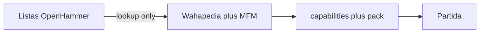

Current selectable status (19 October 2026): the runtime represents all 85 shared-book Marine identities from the local Wahapedia e11 export, including Wardens of Ultramar. The Wardens profile and pre-battle redeployment have passed focused local admission and combat checks. Four non-Marine profiles remain outside this catalog. Network validation is deferred to final integration; full faction/army legality remains uncertified.

Previous snapshot (18 October 2026, before targeted local validation): [Gravis Captain and Terminator Ancient](marine-gravis-ancient-batch.md) brought the runtime to 24 Marine identities and four Necrons. Its tests have since passed as recorded in the linked batch report.

Current Terminator Captain increment (18 October 2026): [Captain in Terminator Armour](marine-terminator-captain.md) adds the 90-point Leader, Strategic Acumen, Transhuman Strategist, Deep Strike, optional free charge reroll and independent weapon replacements. Admission covers twenty-two shared-book Marine identities and four Necron identities; 63 shared-book Marine identities remain unadmitted. Network validation remains deferred and full faction/army certification incomplete. Earlier increments below are historical.

Current Terminator Chaplain increment (18 October 2026): [Chaplain in Terminator Armour](marine-terminator-chaplain.md) adds the 75-point Leader, unit mortal-wound Feel No Pain 4+, melee Lance, Deep Strike and reversible Relic Shield. Attached Characters now count toward reserve costs. Admission covers twenty-one shared-book Marine identities and four Necron identities; 64 shared-book Marine identities remain unadmitted. Network validation remains deferred and full faction/army certification incomplete. Earlier increments below are historical.

Current Apothecary increment (18 October 2026): [Apothecary and shared healing](marine-apothecary.md) add the 45-point Support, Narthecium D3+1 healing with confirmed return previews, and the explicit Apothecary/Lieutenant attachment exception. Admission now covers twenty shared-book Marine identities and four Necron identities; 65 shared-book Marine identities remain unadmitted. Network validation remains deferred and full faction/army certification incomplete. Earlier increments below are historical.

Current Ancients increment (18 October 2026): [Ancient and Bladeguard Ancient](marine-ancients.md) add distinct 40/70-point Support profiles, Raise the Banner, Honour of the Company, Deeds of Legend and the ordinary Ancient’s reversible equipment option. Support construction now checks a complete compatible assignment, and split melee declarations distribute the Deeds attack only once. Admission now covers nineteen shared-book Marine identities and four Necron identities; 66 shared-book Marine identities remain unadmitted. Network validation stays deferred, and full faction/army certification remains incomplete. Earlier counts below are historical increments.

Current Bladeguard increment (18 October 2026): [Bladeguard Veterans](marine-bladeguard.md) add 3/6-model formations, Sergeant pistol choices and the once-per-turn offensive/defensive choice before attack dice. Captain, Chaplain, Lieutenant and Judiciar links are enabled for this bodyguard. Admission now covers seventeen shared-book Marine identities and four Necron identities; 68 shared-book Marine identities remain unadmitted. Only two Bladeguard copies are admitted; later-copy prices remain outside scope. Network validation stays deferred, and full faction/army certification remains incomplete. Earlier counts below describe historical increments.

Current Judiciar increment (18 October 2026): [Judiciar](marine-judiciar.md) adds its 50-point shared-book profile, mandatory Support attachment, unit Fights First from a living Tempormortis source, and melee-only 4+ invulnerable protection across automatic and manual allocation. Admission now covers sixteen shared-book Marine identities and four Necron identities; 69 shared-book Marine identities remain unadmitted. Network validation remains deferred and full army/faction certification remains incomplete. Earlier counts below are historical increments.

Current Chaplain increment (18 October 2026): [Chaplain](marine-chaplain.md) adds its current 60-point profile, Warlord/Leader declarations, Litany of Hate and once-per-round Spiritual Leader, including the same-start-window interaction with Smokescreen. Admission now covers fifteen shared-book Marine identities and four Necron identities; 70 shared-book Marine identities remain unadmitted. Existing scope limits and deferred networking remain in force. Earlier counts below are historical increments.

Current marksmen expansion, 18 October 2026: [Eliminator Squad](marine-eliminators.md) and [Sternguard Veteran Squad](marine-sternguard.md) are admitted with their documented equipment and executable unit abilities; core Smokescreen is implemented for the ground-level cylindrical proxy. There are fourteen selectable shared Marine identities and four Necron identities. This bounded admission is not full faction, army or match certification; network checks remain deferred. Historical counts below are retained as increment history.

# Faction catalog admission (after Track A)

Current admitted Gravis additions: [Aggressors and Apothecary Biologis](marine-gravis.md), following the Infernus/Hellblaster increment. Continue remaining Marine coverage with local validation; network remains a final integration task.

18 October priority update: the user requested Space Marines implementation before final network validation. [Infernus and Hellblasters](marine-fire-support.md) are the first additional runtime slice; continue shared Marine mechanics and then chapter-specific scope. The older Chronomancer-first sequence below is deferred while this Marine work is active. Local source/admission/combat checks continue.

Product destination: every **current e11** Space Marines (Codex common) and Necrons datasheet can be chosen in a match, with wargear, enhancements and detachments only when the engine already has the keyword. This document is the pipeline; it does not admit Chronomancer or any other new datasheet yet.

## Player-facing rule

- **Listas** shows the OpenHammer catalog (lookup).
- The match only admits units whose capability is `supported` in [capabilities.gd](../scripts/edition_11/capabilities.gd).
- A blocked unit stays visible and states why. It never disappears.

## Admission sequence (one datasheet at a time)

1. Take the OpenHammer `id` from `https://openhammer-api-production.up.railway.app/v1/11e/units`.
2. Cross-check the printed datasheet on Wahapedia `/wh40k11ed/` and the live MFM 1.6 card: models, points, Leader/Support pairings, keywords, weapons, abilities.
3. Reject API composition/points when they diverge (examples already seen: Warriors as 11 models, Doomsday Ark as 2 models).
4. Import a local pack profile with verified base millimetres, stats and weapons.
5. Implement abilities as executable rules, not by running ability prose.
6. Register the datasheet and each ability in `capabilities.gd`; add roster prices only after MFM 1.6 confirmation.
7. Tests: admission, illegal pairing, and the new rule windows.

## First datasheet after Track A closes

**Chronomancer** (`5b7d-54ea-f7a8-9688`): Support on Warriors/Immortals, like Lieutenant. Needs Stealth, melee -1 to hit (Timesplinter Mantle), and Chronometron (5" Normal move after shooting if unengaged; then cannot charge). Wahapedia weapon name is Aeonstave; do not copy the API's "Chronomancer's stave" without that check. MFM/Wahapedia first-copy cost is 70.

After Chronomancer: Skorpekh Destroyers + Skorpekh Lord, then Scarab Swarms, Wraiths, Doomsday Ark. New shared keywords (Vehicle, Fly, Stealth, Support-Necron, Damaged) are implemented as engine features before the first datasheet that needs them.

## Out of this pipeline

- Using OpenHammer JSON as match authority
- Admitting 132 Marine + 67 Necron records in one change
- Chapter-specific Marine catalogues until the common Codex path is stable
