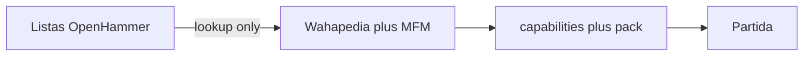

# Faction catalog admission (after Track A)

Product destination: every **current e11** Space Marines (Codex common) and Necrons datasheet can be chosen in a match, with wargear, enhancements and detachments only when the engine already has the keyword. This document is the pipeline; it does not admit Chronomancer or any other new datasheet yet.

## Player-facing rule

- **Listas** shows the OpenHammer catalog (lookup).
- The match only admits units whose capability is `supported` in [capabilities.gd](../scripts/edition_11/capabilities.gd).
- A blocked unit stays visible and states why. It never disappears.

## Admission sequence (one datasheet at a time)

1. Take the OpenHammer `id` from `https://openhammer-api-production.up.railway.app/v1/11e/units`.
2. Cross-check the printed datasheet on Wahapedia `/wh40k11ed/` and the live MFM 1.6 card: models, points, Leader/Support pairings, keywords, weapons, abilities.
3. Reject API composition/points when they diverge (examples already seen: Warriors as 11 models, Doomsday Ark as 2 models).
4. Import a local pack profile with verified base millimetres, stats and weapons.
5. Implement abilities as executable rules, not by running ability prose.
6. Register the datasheet and each ability in `capabilities.gd`; add roster prices only after MFM 1.6 confirmation.
7. Tests: admission, illegal pairing, and the new rule windows.

## First datasheet after Track A closes

**Chronomancer** (`5b7d-54ea-f7a8-9688`): Support on Warriors/Immortals, like Lieutenant. Needs Stealth, melee -1 to hit (Timesplinter Mantle), and Chronometron (5" Normal move after shooting if unengaged; then cannot charge). Wahapedia weapon name is Aeonstave; do not copy the API's "Chronomancer's stave" without that check. MFM/Wahapedia first-copy cost is 70.

After Chronomancer: Skorpekh Destroyers + Skorpekh Lord, then Scarab Swarms, Wraiths, Doomsday Ark. New shared keywords (Vehicle, Fly, Stealth, Support-Necron, Damaged) are implemented as engine features before the first datasheet that needs them.

## Out of this pipeline

- Using OpenHammer JSON as match authority
- Admitting 132 Marine + 67 Necron records in one change
- Chapter-specific Marine catalogues until the common Codex path is stable
