# End-to-end gameplay flow audit

**Observed:** 7 November 2026 · **Mode:** local hot-seat tactical training · **Display:** 1920 × 1080 · **Result:** draw, P1 0 VP / P2 0 VP

## Summary

One complete five-round match was played through the live Godot UI. Both armies deployed, both players passed through all five phases in every turn, all eligible reactions were declined, the mission reached its recorded end state, and the result card displayed a 0–0 draw.

The route required **171 accepted, screen-advancing clicks** under this no-action simulation. This is a reproducible route count reconstructed from each observed transition, not raw mouse-event telemetry. It excludes a retry that did not advance the screen. It also excludes active unit/model selection and tactical orders: no unit moved, shot, charged or fought. An active match will require additional inputs.

The main flow cost came from repeated optional decisions and hot-seat ownership changes. The audit counted 30 clicks across the ten Fire Overwatch windows and 27 across nine Heroic Intervention windows. The handoff screens serve a privacy purpose in local play, so removing them blindly would expose one player's choices to the other. The clearest candidates are reducing confirmations for validated defaults and automatically progressing only through phases that have no legal choices or pending decisions.

## Scope and setup

- Started **Start tactical training**, using the local Fire and Manoeuvre force against Close Assault.
- The training guide lists 290 points for Fire and Manoeuvre and 235 points for Close Assault. These asymmetric totals are part of the exercise, not a balance or legality finding.
- P1 declared Captain 1 as Warlord; P2 declared Chaplain 1. No optional Leader attachments were made.
- Deployed six units in alternating order: P1 Captain, P2 Assault Intercessors, P1 Hellblasters, P2 Bladeguard Veterans, P1 Intercessors, P2 Chaplain. For each unit, accepted the suggested preview positions and confirmed deployment.
- Played five rounds of the custom objective training mission with Fire and Manoeuvre and Close Assault. No objective score was recorded; the final result card showed a draw at 0 VP each.
- Optional Fire Overwatch and Heroic Intervention offers were declined. No attacks or damage were resolved, and no CP-costing reaction was confirmed.

This is an audit of the observed UI path, not a rules certification, competitive balance review, army-legality check, or human comprehension study. The custom mission and training boundary are described in [Tactical training](../guides/tactical-training.md) and [Objectives](../rules/objectives.md).

## Click count

| Segment | Accepted clicks | What was counted |
|---|---:|---|
| Entry, army preparation and deployment | 25 | Start training (1); two Warlord confirmations, two Finish army actions and two setup handoffs (6); six deployments, each accepting preview positions, confirming the unit and handing off to the next owner (18). The final handoff enters P1's first Command phase. |
| Round 1, P1 | 11 | Start turn, no-doctrine confirmation, finish Command, close Movement, resolve Fire Overwatch handoff/decline/return, close Shooting, close Charge, complete Fight, end turn. There was no Heroic Intervention decision in this turn. |
| Round 1, P2 | 15 | The same phase path, with the incoming hot-seat handoff and a Heroic Intervention handoff/decline/return after Charge. |
| Rounds 2–5, both players | 120 | Eight turns at 15 clicks each, including Command choices, Fire Overwatch response, Heroic Intervention response, phase advances and hot-seat handoffs. |
| **Total** | **171** | **25 + 11 + 15 + 120** |

### Repeated decisions and transitions

| Interaction | Count in this run | Notes |
|---|---:|---|
| Confirm “No doctrine this turn” | 10 | One Command decision per player turn. |
| Fire Overwatch windows declined | 10 | One after each Movement phase; the decline action showed 0 CP. The offered Captain reaction showed a 1 CP cost. |
| Heroic Intervention windows declined | 9 | Offered after Charge except P1's first turn; the shown ability cost 2 CP. |
| Shooting phase closed without an attack | 10 | One phase advance per turn. No attack plan was created. |
| Charge phase closed without a charge | 10 | The final observed Charge panel showed `Choose a unit (0)`. No charge roll was made. |
| Fight phase closed after completion | 10 | The UI reported Fight complete and awaited phase progression; no melee attacks were made. |
| Unit preview accepted and deployment confirmed | 6 each | Two explicit actions per deployed unit. |

Each reaction round trip accounts for three accepted clicks: the responding player continues through the handoff, declines the offer, and the active player continues through the return handoff. The 19 observed reaction windows therefore account for 57 clicks. This is **33% of the 171-click route**, and includes the intentional local hot-seat ownership gates.

## End-to-end stage record

1. **Launch:** selected **Start tactical training**.
2. **Army preparation:** P1 confirmed Captain 1 as Warlord, finished army setup, then handed control to P2. P2 did the same with Chaplain 1 and handed control to P1.
3. **Deployment:** each of the six units accepted its visible preview positions, confirmed deployment, and passed the table to the next player. No manual model repositioning was performed.
4. **Command, each turn:** began the turn, confirmed **No doctrine this turn**, then used the Command progression action to enter Movement. No optional Command ability or stratagem was activated.
5. **Movement, each turn:** no models were moved. The phase was closed. The opposing player was offered Fire Overwatch and declined it; control returned to the active player.
6. **Shooting, each turn:** no unit or target was selected and no attack plan was submitted. The phase was advanced to Charge.
7. **Charge, each turn:** no charge was declared or rolled. The phase was advanced. In nine turns, the opposing player received a Heroic Intervention offer and declined it; control returned to the active player.
8. **Fight, each turn:** no pile-in, melee attack or consolidation was performed. The UI marked Fight complete; the player advanced to End of Turn.
9. **End of turn and scoring:** the active player continued. The next player received the hot-seat handoff, or after P2's final turn the match displayed its result.
10. **Result:** after P2 finished Round 5, the result card recorded **EXERCISE COMPLETE · Draw**, with P1 0 VP and P2 0 VP. Result details and Save result were not opened.

```mermaid
flowchart LR
    A[Start tactical training] --> B[Warlords and army setup]
    B --> C[Deploy six units<br/>accept preview + confirm]
    C --> D[Round 1–5: P1 Command]
    D --> E[Movement]
    E --> F[P2 Fire Overwatch decision]
    F --> G[P1 Shooting]
    G --> H[P1 Charge]
    H --> I[P2 Heroic Intervention decision<br/>when offered]
    I --> J[P1 Fight and end turn]
    J --> K[P2 Command → Movement]
    K --> L[P1 Fire Overwatch decision]
    L --> M[P2 Shooting → Charge]
    M --> N[P1 Heroic Intervention decision<br/>when offered]
    N --> O[P2 Fight and end turn]
    O --> P{Round 5 complete?}
    P -- No --> D
    P -- Yes --> Q[Recorded result: draw, 0–0]
```

## UX findings

### What worked

- The phase rail consistently named the round, active player and current phase.
- The decision banner identified who owned a reaction before showing its controls.
- Reaction choices displayed their CP cost, and the no-cost decline action was explicit.
- The final result card made the draw and both VP totals clear without requiring the result-details panel.
- The board remained visible during play, with army state and the contextual action panel available alongside it.

### Friction observed

1. **Deployment uses two confirmations for the default preview.** Each of six units required accepting its preview and then confirming the same deployment. This was clear but repetitive for a training setup with no manual changes.
2. **No-doctrine repeats every turn.** All ten turns required a confirmation even though the same no-doctrine choice was made each time.
3. **Reaction copy mixes an optional action with a required decision.** The Heroic Intervention surface labels itself “OPTIONAL REACTION” and also says “Required: resolve or decline the current unit ability window.” A player can read this as contradictory: spending CP is optional, but responding to the offer is required.
4. **Hot-seat reactions create a long repeated loop.** The player change, decline, and return handoffs are necessary for private local decisions, but they dominate this no-action route.
5. **The main phase action moves with the contextual panel.** On the 1920 × 1080 screen, progression buttons appeared at different vertical positions as panel contents changed or scrolled. A stable action footer could reduce visual re-acquisition.
6. **Empty Charge and completed Fight still needed a phase-advance click.** In the final observed Charge panel the unit picker showed zero eligible units; Fight immediately reported completion. These are good candidates for eligibility-gated auto-progression, while preserving any reaction window.
7. **Objective feedback was minimal during this run.** The top-level VP summary stayed at 0–0 and the result was explicit. The Mission breakdown was not opened, so per-objective explanation and round-end comprehension were not assessed.

## Improvement opportunities

Priority order reflects the observed run. Click-savings figures are scoped to this route and require validation against mandatory decisions before implementation.

1. **Offer a single deploy action for an untouched, valid preview.** Replace the two-step `Accept preview positions` → `Confirm unit deployment` path with a clear `Deploy suggested positions` action. Keep manual placement and its validation route. Potential saving in this run: up to six clicks.
2. **Auto-advance only when a phase has no legal active choices or pending decisions.** Charge showed no eligible units and Fight was already complete. Progress to the next authoritative window, including Heroic Intervention when applicable, without a redundant confirmation. Candidate saving here: up to twenty phase-close clicks across ten empty Charge and ten completed Fight phases; validate every phase boundary and reaction ordering first.
3. **Make the no-doctrine default a direct action.** Present `Continue without a doctrine` as the primary one-click choice, while keeping doctrine selection when available. This could remove one repeated confirmation from each of ten turns without skipping the rest of Command resolution.
4. **Clarify reaction wording and consequences.** Use a sentence such as “Player 1: use Heroic Intervention (2 CP) or decline and return to Player 2.” Keep the decision owner, eligible unit and cost visible together; distinguish the optional ability from the required response.
5. **Anchor the primary phase action.** Keep the main continue/confirm action in a persistent bottom footer while the contextual panel content scrolls. Ensure the disabled state and reason stay legible.
6. **Give a compact round-end objective receipt.** Summarize which objectives scored for each player and why a round awarded no VP, with a link to the existing Mission breakdown. Do not imply provisional movement has changed control.
7. **Measure a real tactical path before tuning overall click goals.** Repeat the route with an actual move, ranged attack, charge, fight and objective capture. Record per-phase time, accepted inputs, retries, legal-choice counts, reaction costs and where players consult Help. A no-op session is useful for exposing structural overhead but cannot estimate clicks in active combat.

The first three input reductions have an upper-bound opportunity of **36 clicks** in this specific run (6 deployment + 20 empty-phase + 10 no-doctrine confirmations). This is a design estimate, not measured implementation savings; it must preserve every required decision and reaction window.

The handoff screens should remain part of local hot-seat play unless a tested privacy-preserving alternative is designed. Reaction prompts protect player ownership; optimizing them must not reveal the opponent's pending choice early or silently remove a legal response.

## Evidence limits and references

- Directly observed in one local two-player hot-seat run on the live Godot UI. The walkthrough reached the recorded end result.
- No code, runtime behavior, or rules were changed by this audit. No test suites were run.
- The 171 count is a manual accepted-transition tally, not instrumented input telemetry. At least one retried click that did not change the screen was excluded.
- No human playtest, LAN session, alternate resolution, keyboard/gamepad navigation review, or active-combat flow was performed for this audit.
- The result and gameplay observations do not establish complete 11th-edition rules support, army legality, mission balance, or network/platform coverage. See the [current support matrix](support-matrix.md).

Related guidance: [Gameplay UI and player flows](../guides/gameplay-ui.md) · [Tactical training](../guides/tactical-training.md) · [Objectives](../rules/objectives.md) · [Prepared custom match](../guides/prepared-match.md).
